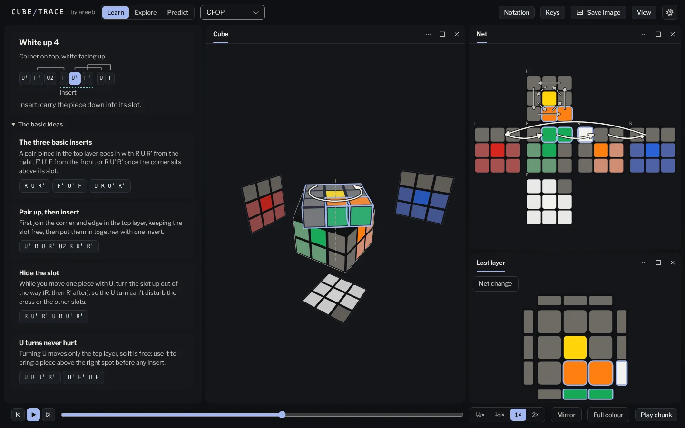

# Cube Trace

Rubik's cube algorithms, turn by turn: which pieces each move carries and where they go.

## Table of Contents

- [About](#about)
- [Screenshots](#screenshots)
- [Features](#features)
- [Technologies](#technologies)
- [Setup](#setup)
- [Usage](#usage)
- [Architecture](#architecture)
- [Project Status](#project-status)
- [Credits](#credits)
- [Author](#author)
- [License](#license)

## About

Cube Trace teaches the beginner method and CFOP by tracking pieces, not stickers, through every turn of an algorithm. You see how an algorithm takes the solved part of the cube apart and puts it back, on a 3D cube, on a flat net and on a last-layer diagram, all drawn from one shared state. It runs entirely in the browser: nothing is sent anywhere.

Live at <https://areeb-ece.github.io/CubeTrace/>.

## Screenshots



## Features

- **Learn:** the beginner method (7 steps) and CFOP (cross, F2L, OLL, PLL), each step's cases as small pictures that load into the player.
- **Explore:** type any moves and watch them; drag across the cube to turn a layer; scramble and reset; a twist ledger for corner orientation.
- **Predict:** before each move (or chunk) one piece is marked and you click the slot it will end up in.
- **Three views** of the same state: the cube in 3D, the unfolded net and the last layer from above, in a docking workspace you can rearrange.
- **Roles, ghosts and hatching:** pieces that matter are in colour, the rest are quiet grey; a displaced piece is hatched and the box it left is drawn as a dashed ghost.
- **Timeline:** the moves as chips with brackets over moves that undo each other, chunks (triggers, inserts, commutators and conjugates) and a "where X and Y meet" view.
- **Notation primer** and a Keys dialog; letters on stickers for colour-blind use; mirror panes.
- **Save image:** a PNG of the current position or a GIF of the whole algorithm, in any of the views side by side, in this theme, Night or Paper, with an optional title block and see-through background.
- Keyboard operable, with named canvases and visible focus; reduced motion keeps the arrows and outlines and only drops the movement.

## Technologies

- Vanilla ES modules, HTML and CSS: no build step, no framework, no runtime dependencies (`package.json` lists none).
- Canvas 2D for every drawing, including the 3D cube (painted from projected polygons in painter's order).
- A hand-written GIF writer in `js/lib/gif.js`.
- The shared design files from [areeb-ece.github.io](https://areeb-ece.github.io/) (`/design/`: themes, tokens, components, settings panel), with an offline copy in `assets/design/`.
- Fonts: mononoki (moves, letters; with its OFL text in `assets/fonts/`) and Libre Franklin (text, through the portfolio's `/design/fonts.css`).
- Tests: Node's built-in test runner, Node 22 in CI. The browser check uses Playwright 1.56.1 with Chromium, installed with `--no-save` so it never enters `package.json`.

## Setup

Prerequisite: Node.js (CI uses 22). There is nothing to install to run the site or the unit tests.

```bash
npm run serve        # serves the site at http://localhost:8080/CubeTrace/
npm test             # unit tests (node --test "tests/*.test.js")
```

The browser check needs Playwright and a Chromium:

```bash
npm i --no-save playwright@1.56.1
npx playwright install chromium
npm run test:browser
```

To check against the real shared design files from a checkout of the portfolio next to this repository:

```bash
DESIGN_DIR=../areeb-ece.github.io/public/design npm run test:browser
```

<!-- TODO: say which Node version is the minimum; only CI's 22 is pinned. -->

## Usage

1. Pick **Learn**, choose a method and a step, then a case. Press play (or Space), step with the arrow keys, or drag the position slider.
2. In **Explore**, type moves such as `R U R' U'` in the moves box. Faces are `U D L R F B`, `'` turns back, `2` turns twice, `(…)3` repeats.
3. Use **Save image** in the header to save a PNG or GIF.

## Architecture

```
index.html             the shell and its strict Content Security Policy
css/style.css          local styles, written with the shared design tokens only
js/lib/                THE ENGINE: pure (no DOM), runs in Node, imports only from js/lib/
  cube.js, moves.js, notation.js, trace.js, algebra.js, structure.js, roles.js, scene.js, picture.js, gif.js ...
  content/             the lessons: beginner, CFOP concepts and the F2L, OLL and PLL case sets
js/views/              cube.js, net.js, ll.js, timeline.js: each draws through one pure paint function
js/export/             the Save image dialog and the picture renderer
js/*.js                shell: store, player, docking, Learn, Predict, transport
assets/                icon, fonts, offline copy of the shared design
tests/                 *.test.js (node --test), serve.js, browser-check.js
```

Every highlight, label and trail belongs to a piece (a cubie id) and moves with it. The same paint functions draw the page, the thumbnails and every saved picture.

### How the content is verified

Content is data and is tested: an algorithm that fails its checks does not ship. Each algorithm must parse and round-trip, touch only what its step may touch, and reach its step's goal from its own case. Coverage is computed:

- OLL: 57 of the 58 orientation classes (modulo `U`), each exactly once.
- PLL: 21 of the 22 permutation classes, each exactly once.
- F2L: 41 cases plus solved, which is all 42 classes of one pair.

## Project Status

Complete as planned (milestones 1 to 10).

## Credits

- mononoki, by Matthias Tellen, under the SIL Open Font License (`assets/fonts/OFL-mononoki.txt`).
- Libre Franklin, served through the shared design files of the portfolio.
- `js/lib/gif.js` is copied from [areeb-ece/LaplaceAnalyser](https://github.com/areeb-ece/LaplaceAnalyser) and kept in step with it.

## Author

areeb: [areeb-ece.github.io](https://areeb-ece.github.io/) and [github.com/areeb-ece](https://github.com/areeb-ece).

## License

MIT, see [LICENSE](./LICENSE).
